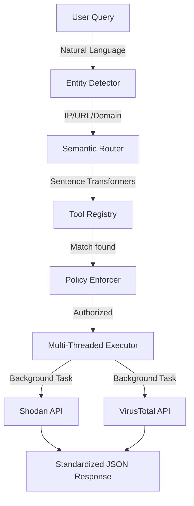

# 🦅 Athena (v1.3)

[](https://modelcontextprotocol.io)
[](https://python.org)
[](LICENSE)

Athena is a high-performance **Model Context Protocol (MCP)** server Runtime designed for autonomous threat intelligence orchestration. It bridges the gap between natural language security queries and technical intelligence APIs like Shodan and VirusTotal.

## 🚀 What's New in v1.3?

- **Agentic mode** for unattended pipelines (first consumer: **TriageLoop**): `ti_lookup` and `ti_lookup_batch` take structured input and return structured output, with no natural-language routing and no questions. See [Agentic mode](#-agentic-mode-triageloop).
- **Shared response cache** for `ti_query` and the agentic tools.
- **JSON Schemas** for every source's `observed_facts` in `schemas/`, and recorded provider fixtures in `fixtures/`.
- `ti_query`, the persona and the three-lane output contract are unchanged.

## What's New in v1.2?

- **Analyst-Augmented Output**: Responses now use a three-lane structure: `observed_facts` (Athena-provided), `analyst_interpretation` (LLM-rendered), and `recommended_next_steps` (LLM-rendered).
- **Senior CTI Persona Prompt**: LLMs must request the `senior_cti_analyst` MCP Prompt at session startup to inject the Senior CTI Analyst persona.
- **Audit Hashing**: Every response includes a `persona_hash` (SHA256) in the audit block for verification.
- **Clean Separation of Authority**: Athena provides authoritative facts; the LLM provides interpretive analysis. Never the other way around.
- **Schema Version Flags**: All responses include `version: "1.2"` and `rendering_mode: "analyst_augmented"`.
- **Enhanced Guardrails**: The persona explicitly prohibits the LLM from claiming execution, issuing verdicts, or fabricating data.

---

## 🛡️ Security & Auditing

Athena is built for high-security environments. We **highly encourage** users to monitor their audit logs:
- **Location**: `logs/audit.jsonl`
- **What's tracked**: Every query, detected entity, tool selected, confidence score, and raw API response.
- **Best Practice**: Feed this file into your SIEM or a local monitoring dashboard to track agentic behavior and catch malicious queries in real-time.

---

## 🛠️ System Architecture

Our architecture is built for extreme scalability and "Imagination-driven" growth.



### The 3-Layer Logic:
1.  **Deterministic Entity Detection**: Regex-based classification of Technical Identifiers (IPs, URLs, Domains, **and Hashes**).
2.  **Semantic Intent Matching**: Using `all-MiniLM-L6-v2` to match conversational "vibes" to technical tool capabilities with a configurable threshold.
3.  **Encapsulated Policy Layer**: Ensures API keys, rate limits, and credit tiers are respected before any network call is made.

---

## 🛠️ Tools Included

| Tool | Trigger Intent (Examples) | Input Entity | Key Required | Risk Tier |
|------|---------------------------|--------------|--------------|-----------|
| **Shodan IP** | "where is this ip", "ports on 1.1.1.1" | Public IP | Yes | Low |
| **VirusTotal Audit**| "scan vt", "is this hash malicious" | URL, Hash | Yes | Medium |
| **AbuseIPDB** | "check ip for abuse", "reputation of IP" | Public IP | Yes | Low |
| **ThreatFox** | "malware hash", "ioc on threatfox" | IP, Domain, URL, Hash | Yes (Auth-Key) | Low |

## 🚀 Getting Started

### 1. Requirements
- Python 3.11+
- [uv](https://docs.astral.sh/uv/)
- API keys for the tools you want to use (Shodan, VirusTotal, AbuseIPDB, ThreatFox)

### 2. Basic Installation

> [!NOTE]
> This project is designed to be lightweight. `pyproject.toml` pins **CPU-only PyTorch** on Linux and Windows, so `uv sync` will not pull the multi-GB CUDA build.

```bash
# Clone the repository
git clone https://github.com/ranjeetreddy14/Athena-mcp.git
cd Athena-mcp

# Create .venv and install exact versions from uv.lock
uv sync

# Run the server (stdio)
uv run python server.py
```

### 3. Configuration
Copy `.env.example` to `.env` and fill in your keys (all variables are documented there):
```env
SHODAN_API_KEY=your_shodan_key
VT_API_KEY=your_vt_key
ABUSEIPDB_API_KEY=your_abuseipdb_key
THREATFOX_API_KEY=your_threatfox_key
ROUTER_THRESHOLD=0.30
```

---

## 🤖 Agentic mode (TriageLoop)

`ti_query` is built for a human talking to an LLM: it routes natural language, asks for approval in conversation, and offers suggestions. An autonomous pipeline needs the opposite. Athena's first agentic consumer is **TriageLoop**, which calls Athena once per indicator during automated case triage and records Athena's version for every case.

Agentic mode adds two MCP tools beside `ti_query`:

| Tool | Input | Output |
|---|---|---|
| `ti_lookup` | `{"source", "indicator_type", "indicator", "caller"}` | one result |
| `ti_lookup_batch` | `{"items": [ti_lookup input, ...]}` (1–25) | `{"ok": true, "results": [...], "athena_version"}`, same order as `items` |

- **source:** `shodan`, `virustotal`, `abuseipdb`, `threatfox`
- **indicator_type:** `ip` (IPv4), `domain`, `url` (http/https), `hash` (MD5/SHA-1/SHA-256)
- **caller:** an identifier for the calling system, e.g. `triageloop`

**Success** returns only what the source reported:
```json
{"ok": true, "source": "threatfox", "indicator_type": "hash", "indicator": "da10fa...95fa",
 "observed_facts": {"ioc": "da10fa...95fa", "malware_family": "Mirai", "confidence": 90, "...": "..."},
 "cached": false, "athena_version": "1.3.0"}
```
`observed_facts` follows `schemas/<source>.json`.

**Failure** is always exactly this, never a question or free text:
```json
{"ok": false, "reason": "approval_required", "source": "virustotal"}
```
Reason codes: `invalid_request`, `unknown_source`, `source_disabled`, `invalid_indicator_type`, `unsupported_indicator_type`, `invalid_indicator`, `non_routable_ip`, `approval_required`, `missing_api_key`, `upstream_rate_limited`, `upstream_error`, `config_error`, `batch_too_large`, `internal_error`.

**What agentic mode will not do:**
- **No judgements.** It never returns a verdict, severity, attribution or remediation. VirusTotal's derived `verdict` field is removed; the engine counts remain. A tripwire test enforces this on every recorded fixture and every failure path.
- **No queries to private targets.** Private, loopback and link-local IPs are rejected, the same rule `ti_query` uses. URLs pointing at such hosts, or at `localhost`, are rejected too.
- **No embedding model.** It never loads the model and never does natural-language routing.

**Approval.** Conversational approval ("yes, proceed") does not exist here; it is configuration. Copy `config/athena.example.json` to `config/athena.json`, or point `ATHENA_CONFIG` at a file:
```json
{"trusted_callers": ["triageloop"], "medium_risk_requires_approval": true,
 "cache": {"dir": "cache", "ttl_seconds": 3600}}
```
Low-risk sources are always allowed. Medium-risk sources (VirusTotal) need the caller to be in `trusted_callers`, unless `medium_risk_requires_approval` is `false`. Otherwise the call returns `approval_required`. Defaults are fail-safe: no trusted callers, approval required. `caller` is self-declared: it is policy, not authentication.

**Cache.** Results are cached on disk per `(source, indicator)` for `ttl_seconds` (default 3600; `0` disables). The cache is shared with `ti_query` and stores only successful lookups. Override with `ATHENA_CACHE_DIR` / `ATHENA_CACHE_TTL`. A cache hit returns `"cached": true`.

**Audit.** Every agentic call writes one entry to the audit log (one per item for batches) with `routing: "agentic"`, `caller`, `source`, `indicator_type`, `indicator`, `executed_tool` (`null` if nothing ran), `cache_hit`, `ok`, `reason`, and `batch_id`/`batch_index` for batches.

**Discovery.** `ti://capabilities` lists all MCP tools and carries `athena_version` (the value TriageLoop records), plus an `agentic_mode` block with the contract version, sources, reason codes and limits.

---

## 📂 Project Structure
- `server.py`: The MCP entry point & stdio handler.
- `orchestrator/`: The "Brain" (Router, Registry, Logic). `agentic.py`, `cache.py`, `config.py` and `indicators.py` implement agentic mode.
- `tools/`: Atomic implementations of TI lookups.
- `registry/`: Intent phrases & tool definitions (`tools.json`).
- `schemas/`: JSON Schema for each source's `observed_facts`.
- `fixtures/`: Recorded, sanitised provider responses used by the tests (`scripts/record_fixtures.py` re-records them).
- `config/`: `athena.example.json` (agentic approval policy and cache).
- `logs/`: Persistent JSON auditing for security review.

---

## 🧩 Adding Custom Tools

Athena is designed for extreme extensibility. You can add your own private intelligence sources in minutes.

### 1. Create the Tool Script
Add a new file in `tools/` (e.g., `tools/misp_tool.py`):
```python
import os
import requests

def execute(observable: str) -> dict:
    # Athena automatically passes the detected IP/URL/Hash here
    api_key = os.getenv('MY_API_KEY')
    # Use requests to fetch data and return a flat dictionary
    return {"status": "ok", "verdict": "safe", "data": {...}}
```

### 2. Register Your Tool
Add an entry to `registry/tools.json`:
```json
{
  "name": "my_custom_tool",
  "input_types": ["ip", "hash"],
  "intents": [
    "check my internal database for this ip",
    "search misp for hash",
    "has our SOC seen this before"
  ],
  "risk_tier": "low",
  "requires_user_approval": false,
  "enabled": true,
  "requires_api_key": true,
  "env_var_name": "MY_API_KEY"
}
```

### 3. Restart & Profit
Restart the Athena server. The Sentence Transformers model will automatically encode your new intents, and Athena will begin routing relevant queries to your tool immediately.

---

## 📜 License & Rights
This project is licensed under the MIT License - see the [LICENSE](LICENSE) file for details.

**Copyright (c) 2025 Ranjeet Reddy Manchana**

> [!NOTE]
> The author reserves the right to change the license or move to a closed-source model for future releases at their discretion.

---

*“Imagination is the key for scalability.”* – Created by **Ranjeet Reddy Manchana** for the next generation of agentic defense.
